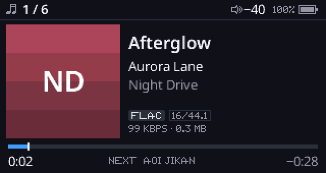

# ReChord simulator

ReChord's own firmware code running in a window on a PC: the same UI, screens, themes, fonts, key
handling, file system, library index, playlists, play queue and settings as on the Echo Mini. Only
the hardware underneath is replaced. You can try a UI change in seconds, without flashing anything.



## What is real and what is simulated

| Part | In the simulator |
| --- | --- |
| UI, navigation, themes, fonts, toasts, the shortcut layer | the firmware's code, unchanged |
| Keys | the firmware's input code, fed the key ladder's voltages from your keyboard |
| Internal storage, microSD card | disk-image files (FAT32), read and written by the firmware's own file system |
| Library index, favourites, playlists (M3U8), `RECHORD.CFG`, `ECHOLOG.TXT` | written into the image, so they are still there on the next run |
| Playback | the firmware's queue (shuffle, repeat, skip, seek, pause, volume in dB). Tracks are decoded by **ffmpeg** on the PC, not by core B's decoders |
| Screen-off timer, power-key screen toggle, hold-power-to-switch-off | as on the device |
| Battery | always 100 % |
| EQ | the screens work, but the sound is not equalised (core B's EQ isn't simulated) |
| USB (disk, DAC, USB-C out), Bluetooth, firmware update, Recovery tools | absent: no cable, no module, no update image |

The firmware sources are not changed for the simulator. `sim/*.c` provides the hardware functions
(clock, keys, backlight, storage, audio, overlays) and the Makefile builds the firmware's files for
the PC.

## Set it up on Windows (WSL)

1. In PowerShell as administrator: `wsl --install`, then restart. Ubuntu opens; pick a user name.
   Windows 11 shows Linux windows and plays their sound without anything else.
2. In Ubuntu:

   ```bash
   sudo apt update
   sudo apt install build-essential libsdl2-dev ffmpeg mtools dosfstools git
   git clone https://github.com/AlanRSV/ReChord.git
   cd ReChord
   make sim
   ```

3. Make a disk image from a music folder. Windows drives are under `/mnt/c`:

   ```bash
   sim/mkimage.sh "/mnt/c/Users/<you>/Music/Echo Mini" build/sim/internal.img
   ```

   Use the folder you would copy to the player (an Echo Library-organised folder works as is, with
   its playlists in `RECHORD/`). The image is the folder's size plus 64 MB.

4. Run it:

   ```bash
   build/sim/rechord_sim build/sim/internal.img
   ```

An image under `/mnt/c` is slow to read through WSL: keep it on Ubuntu's own disk instead, for
example `sim/mkimage.sh "/mnt/c/..." ~/rechord/internal.img`. Then `sim\run-sim.cmd` starts the
simulator from Windows (double-click it, or run it from PowerShell): the 8 GB board
(`make sim BOARD=8g`) on `~/rechord/internal.img`. `--512` picks the 512 MB build, other options
pass through, and `set RECHORD_IMG=...` picks another image.

On Linux it's the same without step 1 (`sudo apt install` or your distribution's packages).
On macOS: `brew install sdl2 ffmpeg mtools dosfstools`, then steps 2 to 4.

## Keys

| Keyboard | Echo Mini |
| --- | --- |
| Up | VOL+ (up in lists) |
| Down | VOL- (down in lists) |
| Enter, Space, Right | PLAY (select) |
| Esc, Backspace, Left | BACK |
| M, Tab | MENU |
| P | POWER (tap: screen off/on, hold 2 s: power off) |
| Up then Down held together | the VOL+/VOL- chord (shortcut layer) |
| F12 | screenshot, saved next to the image as a BMP |
| Ctrl+Q, or close the window | quit |

Holding a key works as on the device (long presses, repeats). With the screen off, VOL+/VOL-/PLAY
work blind and BACK or MENU wakes it, as on the player.

## Options

```text
rechord_sim [--sd sd.img] [--scale N] [--gain DB] [--script FILE] [--headless] internal.img
```

- `--sd sd.img`: a microSD card (any image `mkimage.sh` made). Without it the slot is empty.
- `--scale N`: window size, 1 to 8 times 320x170 (default 3). The window can also be resized.
- `--gain DB`: extra loudness over the firmware's volume (default 20). The player's -40 dB
  default is a headphone level and nearly silent through PC speakers; `--gain 0` is the device's
  own scale.
- `--script FILE`: press keys from a file and save screenshots, then quit (below).
- `--headless`: no window (with `--script`, for automated runs).

`make sim` builds for the 512 MB model, as the firmware's build does; `make sim BOARD=8g` builds
`build/sim/rechord_sim_8g` for the 8 GB one.

## Scripts

One command a line; `#` starts a comment. `sim/demo.keys` is an example.

```text
wait 2500            # let the firmware run (ms)
press DOWN           # tap a key (held 80 ms, then 150 ms pause)
hold BACK 900        # a long press
down UP / up UP      # hold and release separately (chords)
shot home.bmp        # save the screen
quit
```

Keys: `UP DOWN PLAY BACK MENU POWER` (also `VOL+ VOL- SELECT`).

```bash
build/sim/rechord_sim --headless --script sim/demo.keys build/sim/internal.img
```

## Working with the image

The image is an ordinary FAT32 volume 1 MiB in. mtools reads and writes it while the simulator is
closed:

```bash
mdir   -i build/sim/internal.img@@1M ::/RECHORD          # what the firmware wrote
mtype  -i build/sim/internal.img@@1M ::/ECHOLOG.TXT      # the firmware's log
mcopy  -i build/sim/internal.img@@1M -s "New Album" ::/  # add music (then Library > Refresh)
mcopy  -i build/sim/internal.img@@1M ::/RECHORD.CFG .    # the settings file
```

To start fresh, run `mkimage.sh` again.

## Files

- `sim_main.c`: the window, keyboard, scripts, screenshots; runs the firmware on its own thread
- `sim_hw.c`: clock and 10 ms tick, keys, backlight and power, and the absent hardware (USB, BT, DAC)
- `sim_storage.c`: internal storage and the card on image files
- `sim_audio.c`: `audio/audio.h` with ffmpeg and SDL audio
- `sim_ovl.c`: overlays (all linked in: `ovl_get` returns the table directly)
- `mkimage.sh`: makes an image from a folder
